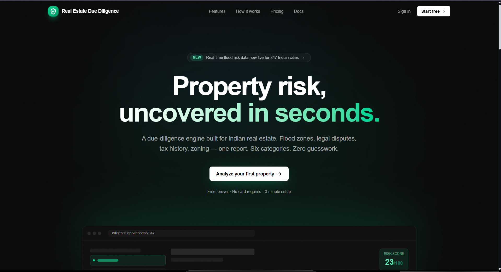
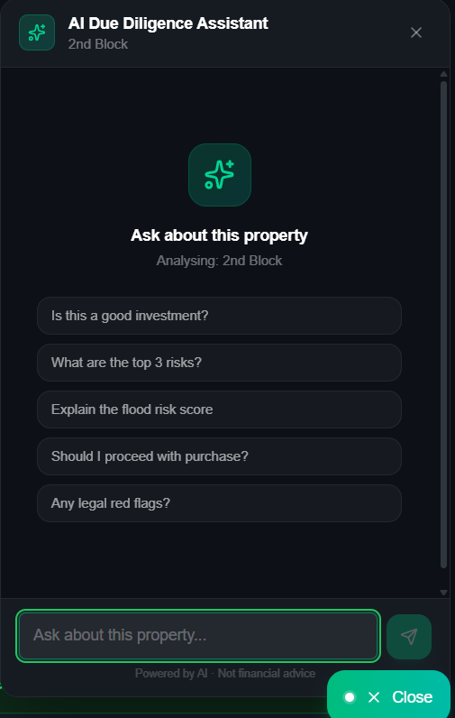
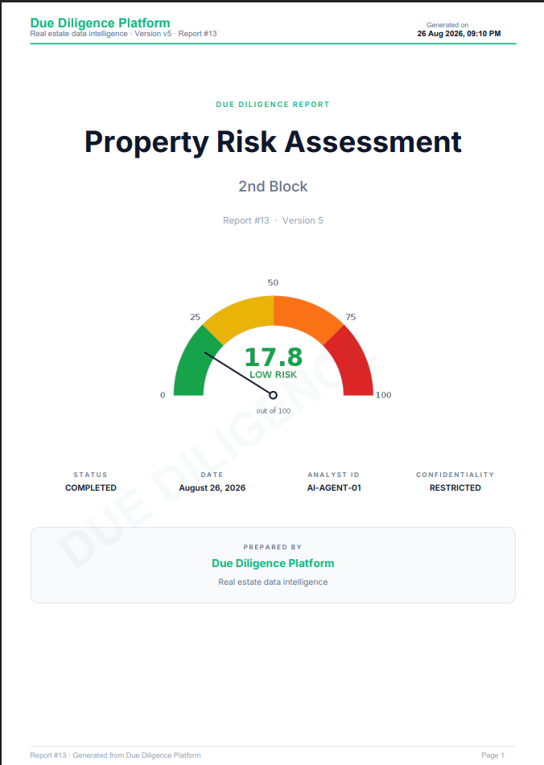
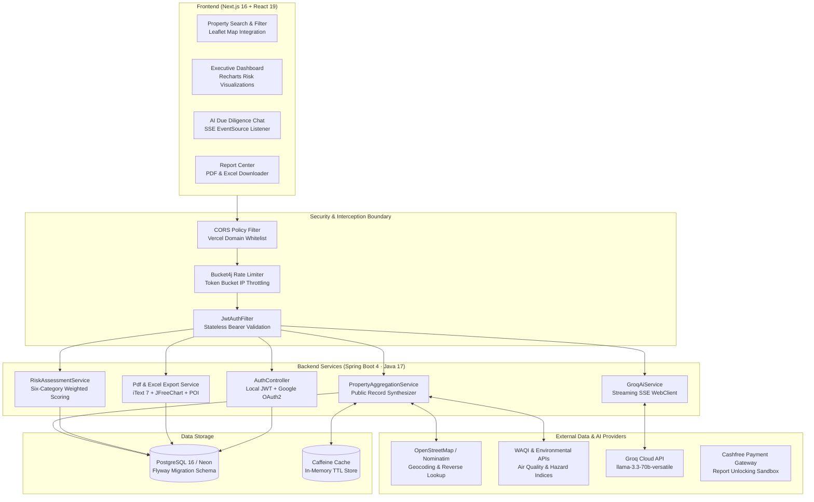

# Real Estate Due Diligence Platform
### Automated Multi-Source Property Risk Assessment, Public Record Aggregation & Investment Verdict Engine

[](https://www.oracle.com/java/)
[](https://spring.io/projects/spring-boot)
[](https://nextjs.org/)
[](https://www.postgresql.org/)
[](https://groq.com/)
[](https://itextpdf.com/)
[](https://github.com/bucket4j/bucket4j)
[](backend/src/test/)

> **An automated property intelligence platform that aggregates legal, zoning, environmental, flood, and tax data to calculate multi-factor risk scores and deliver actionable investment verdicts: BUY, NEGOTIATE, or AVOID.**

---

## Project Overview

Real estate acquisitions often conceal critical liabilities: unrecorded municipal tax liens, restrictive zoning setbacks, FEMA flood hazard boundary expansions, unpermitted building modifications, and title encumbrances. In traditional property transactions, conducting due diligence requires manually navigating siloed government registries, environmental databases, and tax assessors—a process taking weeks and leaving investors vulnerable to hidden expenses.

The **Real Estate Due Diligence Platform** automates property evaluation. Given a property identifier, geographic coordinate, or address, the engine aggregates multi-source public records, evaluates cross-category risk factors, compiles interactive maps and charts, and delivers an algorithmic investment verdict (**BUY**, **NEGOTIATE**, or **AVOID**) accompanied by a streaming AI assistant and publication-grade PDF/Excel reports.

### Core Engineering Highlights

1. **Six-Factor Algorithmic Risk Engine**: Aggregates disparate public datasets across six distinct risk dimensions (Legal, Zoning, Flood/Hazard, Tax, Valuation, and Environmental), generating a normalized composite risk score ($0 - 100$) mapped to strict investment recommendations.
2. **Streaming AI Due Diligence Assistant**: Integrates Groq's high-throughput LLaMA 3.3 70B model (`llama-3.3-70b-versatile`) via Spring WebFlux Server-Sent Events (SSE) streaming at ~500 tokens/sec, injecting retrieved property dossiers into model prompts for source-grounded answers.
3. **Stateless Dual-Authentication Security**: Implements Spring Security with stateless JSON Web Tokens (`jjwt` 0.12) and Google OAuth2 ID token verification, backed by Bucket4j token bucket rate limiting on sensitive evaluation endpoints.
4. **Automated Document Generation Pipeline**: Programmatically compiles multi-page due diligence dossiers utilizing iText 7 layout engines and embedded JFreeChart vector charts (financial donuts, risk spectrum bars) alongside Apache POI Excel exports.
5. **Decoupled Architecture**: Designed around a Spring Boot 4 / Java 17 backend and a Next.js 16 (App Router) / React 19 frontend with Leaflet mapping and Recharts telemetry.

---

## Deployment Status

> [!NOTE]
> **Deployment State Disclosure (October 2026):**
> * **Frontend Client**: Deployed on Vercel at [**https://due-deligence-platform.vercel.app**](https://due-deligence-platform.vercel.app) (accessible). The landing page, UI navigation, and static components remain interactive.
> * **Backend API Service**: Previously hosted on an AWS EC2 demo instance. The cloud host is currently offline following expiration of the evaluation server.
> * **Local Evaluation**: Full end-to-end functionality—including PostgreSQL database persistence, live Groq AI streaming chat, PDF export, and risk scoring—can be evaluated locally using the [Docker Compose Setup](#docker-compose-setup) or the [Local Development Setup](#local-development-setup) detailed below.

---

## Application Walkthrough & Visual Evidence

| Landing Page & Property Search | AI Due Diligence Assistant | Consolidated Risk Report |
|---|---|---|
|  |  |  |
| *Property search portal with geographic filtering and quick-lookup features.* | *Streaming AI chat powered by Groq LLaMA 3.3, citing verified property records.* | *Multi-category risk breakdown with normalized score and BUY/NEGOTIATE/AVOID verdict.* |

---

## System Architecture



---

## Core Engineering Implementations

### 1. Six-Factor Risk Scoring Engine ([`RiskAssessmentServiceImpl.java`](backend/src/main/java/com/realestate/duediligence/service/impl/RiskAssessmentServiceImpl.java))

The platform computes an objective risk assessment by aggregating evaluations across six core domain pillars:

$$\text{Composite Risk} = \sum_{i=1}^{6} w_i \times R_i \quad \text{where} \quad \sum w_i = 1.0$$

| Risk Category | Key Signals Evaluated | Critical Risk Flags |
| :--- | :--- | :--- |
| **1. Legal & Title Risk** | Encumbrances, lien registry, title clear flags, boundary litigation | Unresolved court disputes, ambiguous heirship claims |
| **2. Zoning & Regulatory** | Permitted land use, Floor Area Ratio (FAR), setback compliance | Unauthorized commercial activity, non-conforming structures |
| **3. Flood & Hazard** | FEMA zone classification, elevation delta, historical inundation | FEMA Zone A/V, 100-year flood zone overlap |
| **4. Tax & Financial** | Property tax delinquency history, special municipal levies | Consecutive overdue tax cycles, pending municipal auction |
| **5. Valuation & Market** | Price-per-sqft variance vs neighborhood median, comps deviation | $> 25\%$ deviation from historical fair-market cluster |
| **6. Environmental** | Air quality index (WAQI), industrial proximity, soil hazards | Proximity to hazardous industrial dump or brownfield site |

#### Investment Verdict Logic
The final investment verdict is mapped deterministically from the composite risk score:
* **BUY** ($0 \le \text{Score} \le 30$): Low overall risk. Property records are clean, zoning is compliant, and no severe liabilities exist.
* **NEGOTIATE** ($31 \le \text{Score} \le 65$): Moderate risk. Identified liabilities (e.g. minor tax arrears or zoning variances) should be leveraged for purchase price deductions.
* **AVOID** ($66 \le \text{Score} \le 100$): Severe risk. Disqualifying defects detected (e.g. unresolvable title disputes, flood zone exposure, or structural regulatory violations).

### 2. Streaming AI Agent with Retrieval Context ([`AgentChatController.java`](backend/src/main/java/com/realestate/duediligence/controller/AgentChatController.java))

Rather than generating generic conversational answers, the platform's AI Assistant grounds responses strictly in aggregated property records:
1. **Dossier Context Assembly**: When a buyer queries the AI assistant, the backend retrieves the property's legal history, tax status, zoning classification, and risk factors from PostgreSQL.
2. **System Prompt Enclosure**: The assembled context is formatted into a system prompt instructing the model to cite verified record attributes and flag unknown data rather than hallucinating.
3. **High-Throughput Streaming**: Dispatches requests to Groq Cloud (`llama-3.3-70b-versatile`) via Spring WebFlux `WebClient`, streaming chunks back to the Next.js client via Server-Sent Events (`text/event-stream`).

### 3. Headless Document Compilation Pipeline ([`PdfExportServiceImpl.java`](backend/src/main/java/com/realestate/duediligence/service/impl/PdfExportServiceImpl.java))

Due diligence reports can be compiled on-demand into publication-grade documents:
* **iText 7 Layout Engine**: Generates multi-page PDF documents with running headers, footers, page numbering, dynamic table layouts, and automated risk color badges.
* **Embedded Vector Visualizations**: Generates JFreeChart in-memory buffered images (financial distribution donuts, risk breakdown bar charts) and embeds them directly into PDF document streams.
* **Spreadsheet Generation**: Apache POI compiles complete structured workbooks with formula cells, styling, and multi-tab categorization for financial analysts.

### 4. Security & Access Control ([`backend/src/main/java/com/realestate/duediligence/security/`](backend/src/main/java/com/realestate/duediligence/security/))

* **Stateless JWT Filter**: `JwtAuthFilter` extracts and validates Bearer tokens on incoming requests, verifying HMAC signatures before setting the Spring Security context.
* **Google OAuth2 ID Token Verification**: Validates Google identity tokens server-side via `google-api-client`, creating or linking accounts idempotently.
* **Rate Limiting**: Protects assessment and generation endpoints using Bucket4j token buckets, preventing automated scraper abuse.
* **Input Validation**: Spring Validation (`@Valid`, `@NotNull`, `@Size`) prevents malformed property submissions.

---

## API Overview & Endpoints

The backend exposes RESTful endpoints and SSE streams documented via Springdoc OpenAPI / Swagger UI:

| Method | Path | Purpose | Access |
| :--- | :--- | :--- | :--- |
| `GET` | `/actuator/health` | Service health probe and component status | Public |
| `POST` | `/api/auth/register` | Register new user account | Public |
| `POST` | `/api/auth/login` | Authenticate with email/password; returns JWT | Public |
| `POST` | `/api/auth/google` | Authenticate with Google OAuth2 ID token | Public |
| `GET` | `/api/properties` | Search and filter aggregated properties | Public |
| `GET` | `/api/properties/{id}` | Retrieve property details and public record data | Public |
| `POST` | `/api/properties/{id}/assess` | Run six-factor risk scoring engine | Authenticated |
| `GET` | `/api/reports/{propertyId}` | Retrieve generated due diligence risk report | Authenticated |
| `GET` | `/api/agent/chat/stream` | Streaming AI due diligence assistant (SSE) | Authenticated |
| `GET` | `/api/export/{propertyId}/pdf` | Compile and download formal iText 7 PDF report | Authenticated |
| `GET` | `/api/export/{propertyId}/excel`| Compile and download structured Excel workbook | Authenticated |
| `GET` | `/api/admin/dashboard` | Administrative audit logs and system telemetry | Admin |

*(Interactive Swagger UI is available locally at `http://localhost:8080/swagger-ui/index.html` when running the backend).*

---

## Testing & Quality Assurance

The repository includes test suites covering backend services, integrations, and frontend components:

### 1. Backend Automated Testing (JUnit 5 + Spring Boot Test)
Located in [`backend/src/test/java/`](backend/src/test/java/):
* **Unit Tests**: Verifies risk assessment scoring thresholds, verdict mapping (`RiskAssessmentServiceImplTest`), and document compilation (`PdfExportServiceImplTest`, `ExcelExportServiceImplTest`).
* **Integration Tests**: Executes end-to-end evaluation workflows using an in-memory H2 database under the `test` Spring profile (`EndToEndWorkflowTest`).
* **External Provider Tests**: Validates geocoding and environmental API integration contracts (`NominatimIntegrationTest`, `WAQIIntegrationTest`).

To execute the backend test matrix:
```bash
cd backend
./mvnw test
```

### 2. Frontend Component & E2E Testing (Vitest + Playwright)
Located in [`frontend/src/__tests__/`](frontend/src/__tests__/):
* **Component Suites**: Tests rendering and interaction across risk cards, map components, and report viewers.
* **E2E User Journeys**: Validates login flows, report generation, and property management (`auth-flow.spec.js`, `report-generation.spec.js`).

To execute the frontend tests:
```bash
cd frontend
npm test
```

---

## Local Development & Reproduction

### Prerequisites
* **Java**: OpenJDK 17 LTS (`java -version`)
* **Maven**: 3.9+ (or use included `./mvnw` wrapper)
* **Node.js**: v20.x or v22.x LTS (`node -v`)
* **Database**: PostgreSQL 15+ (or Docker Compose)

---

### Method A: Quickstart via Docker Compose (Recommended)

The fastest way to spin up the entire application stack (PostgreSQL, Spring Boot backend, and Next.js frontend):

```bash
# 1. Clone repository
git clone https://github.com/AkshayAlgoX/due-deligence-platform.git
cd due-deligence-platform

# 2. Configure root environment variables
cp .env.docker.example .env

# 3. Launch the container stack
docker compose up -d
```

* Frontend: `http://localhost:3000`
* Backend API: `http://localhost:8080`
* Swagger UI: `http://localhost:8080/swagger-ui/index.html`

---

### Method B: Manual Local Setup

#### 1. Backend Setup (Spring Boot)
```bash
cd backend

# Configure environment variables
cp .env.example .env
```

Key environment variables in `backend/.env`:
* `SPRING_DATASOURCE_URL`: PostgreSQL JDBC URL (`jdbc:postgresql://localhost:5432/duediligence`)
* `SPRING_DATASOURCE_USERNAME` / `SPRING_DATASOURCE_PASSWORD`: Database credentials
* `JWT_SECRET`: Random 256-bit secret string for token signing
* `GROQ_API_KEY`: API key for Groq LLaMA 3.3 streaming assistant (optional)
* `CASHFREE_APP_ID` / `CASHFREE_SECRET_KEY`: Payment sandbox keys (optional)

Run database migrations and launch the backend:
```bash
# Compile and start Spring Boot
./mvnw spring-boot:run
```
Backend starts on `http://localhost:8080`.

#### 2. Frontend Setup (Next.js)
In a separate terminal:
```bash
cd frontend

# Install dependencies
npm install

# Configure environment variables
cp .env.example .env.local
```

Set `frontend/.env.local`:
```env
NEXT_PUBLIC_API_URL=http://localhost:8080
```

Start development server:
```bash
npm run dev
```
Open [**http://localhost:3000**](http://localhost:3000) to access the application.

---

## Repository Structure

```text
due-deligence-platform/
├── .github/
│   └── workflows/
│       └── ci.yml              # GitHub Actions build and test workflow
├── backend/                    # Spring Boot 4.1.0 API (Java 17)
│   ├── src/main/java/com/realestate/duediligence/
│   │   ├── actuator/           # Custom health indicator & monitoring
│   │   ├── aggregation/        # Multi-source public record aggregation service
│   │   ├── config/             # Security, Async, Cache, OpenAPI configuration
│   │   ├── controller/         # REST endpoints (properties, reports, risk, auth)
│   │   ├── dto/                # Request & response data transfer objects
│   │   ├── entity/             # JPA entities (Property, Report, User, AuditLog)
│   │   ├── export/             # Apache POI Excel workbook generators
│   │   ├── integration/        # External API connectors (Nominatim, WAQI)
│   │   ├── pdf/                # iText 7 report compiler & JFreeChart renderers
│   │   ├── repository/         # Spring Data JPA repositories
│   │   ├── security/           # JWT authentication filter & token provider
│   │   ├── service/            # Business logic (RiskAssessment, Report, Property)
│   │   └── DueDiligenceAgentApplication.java
│   ├── src/main/resources/     # Application YAML, Flyway database migrations
│   ├── src/test/               # JUnit 5 integration & unit test suites
│   ├── pom.xml                 # Maven project configuration
│   └── mvnw                    # Maven wrapper script
├── frontend/                   # Next.js 16 (App Router) + React 19 Client
│   ├── src/
│   │   ├── app/                # App router pages (dashboard, reports, search, auth)
│   │   ├── components/         # Reusable UI components, risk cards, charts
│   │   ├── hooks/              # Custom React hooks (chat, risk, valuation)
│   │   ├── services/           # Axios REST API connectors & SSE listeners
│   │   └── __tests__/          # Vitest component & Playwright E2E suites
│   ├── public/                 # Static assets and icons
│   └── package.json
├── docs/                       # Architectural documentation & technical specifications
│   ├── ARCHITECTURE.md         # System design, scoring models, and integration specs
│   ├── DEPLOYMENT.md           # Multi-tier deployment blueprints
│   └── screenshots/            # Authentic application walkthrough screenshots
├── docker-compose.yml          # Container configuration for local stack reproduction
└── README.md
```

---

## Authorship & Project Attribution

Developed as an enterprise software engineering project during the **Infosys Springboard** program by **Team 03**:

* **Akshaya R** ([@AkshayAlgoX](https://github.com/AkshayAlgoX)) — **Team Lead**
  * *Core Contributions:* Backend architecture, Spring Security / JWT authentication, multi-source service aggregation pipeline, six-category risk scoring engine, and deployment orchestration.
* **Team Members (Team 03):**
  * **MelvinBritto**
  * **Bhavana-Bhat-528**
  * **tanishaalone-lab**
  * **subashs0411**
  * **DempRepo**
  * **[NalamothuLokesh](https://github.com/NalamothuLokesh)**
* **Project Mentorship:** springboardmentor198 (Infosys Springboard)
* **License:** MIT License. See [LICENSE](LICENSE) for details.
